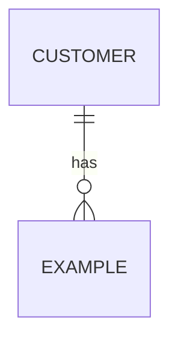
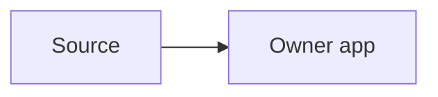

# {{Gate}} pack: {{module}} ({{slug}})
<!-- One page. Mermaid diagrams. Label sections with their TOGAF phase. -->

## A Architecture Vision
- Confirmed bullets: {{link to CONFIRM FIRST bullets}}. Stakeholders: {{roles}}. Constraints: {{constraints}}.

## B Business
- Capabilities: {{list}}
- Processes and roles: {{list}}

## C Data
| Entity | Reused / Extended / New | Owner (app/module) | Notes |
|---|---|---|---|
| {{Customer}} | Reused | erpnext | {{Link only}} |

## C Application
| Capability | Placement | Generic or customer | Why |
|---|---|---|---|

## D Technology
- Stack, hosting, integrations: {{list}}

## Decisions (ADRs)
- ADR-{{NNN}}: {{title}}, see `adr/`

## Requirement coverage
| Req ID | exists / extend / new | Owner |
|---|---|---|
